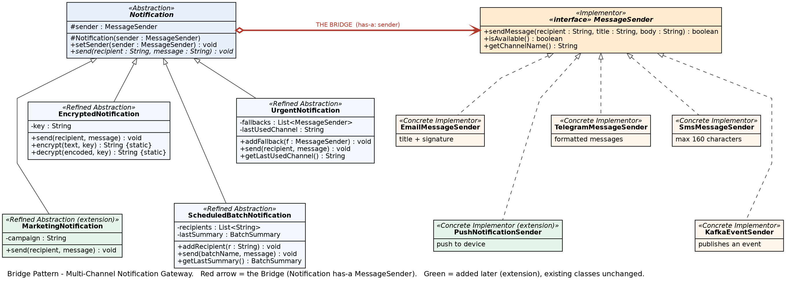

# Multi-Channel Notification Gateway (Bridge Pattern)

**Course:** Software Design Patterns | **Assignment 3** | **Language:** Java 17 | **Build:** Maven + JUnit 5

**Author:** Gulsezim Kapizova, SE2517

## Overview

A notification gateway that sends different **types** of notifications through different **delivery providers**. The Bridge pattern keeps both dimensions independent, so the number of classes grows as N + M instead of N × M. All providers are simulated, no real external APIs are used.

## UML Class Diagram



| Bridge role | Class |
|---|---|
| Abstraction | `Notification` |
| Refined Abstractions | `UrgentNotification`, `EncryptedNotification`, `ScheduledBatchNotification`, `MarketingNotification` |
| Implementor | `MessageSender` |
| Concrete Implementors | `TelegramMessageSender`, `EmailMessageSender`, `SmsMessageSender`, `KafkaEventSender`, `PushNotificationSender` |
| The Bridge | field `protected MessageSender sender` in `Notification` |

## Project structure

```
src/main/java/com/gateway
├── Main.java
├── sender         (implementor hierarchy)
└── notification   (abstraction hierarchy)
src/test/java/com/gateway
└── NotificationGatewayTest.java
```

## Features

- **TelegramMessageSender** formats the message (bold title, italic body).
- **EmailMessageSender** adds a subject line and a signature.
- **SmsMessageSender** rejects messages longer than 160 characters (`MAX_LENGTH`) and requires a phone number starting with `+`.
- **KafkaEventSender** simulates publishing an event to a topic.
- **PushNotificationSender** simulates a push to a device (added as an extension).
- **UrgentNotification** adds `[URGENT]`, checks `isAvailable()` and uses fallback senders through the `MessageSender` interface only.
- **EncryptedNotification** transforms the message with XOR + Base64 before sending.
- **ScheduledBatchNotification** sends to a collection of recipients and prints a summary (`Total / Successful / Failed`).
- **MarketingNotification** adds a campaign tag and an unsubscribe footer (added as an extension).
- **Runtime switching:** `notification.setSender(otherSender)` changes the provider without touching the notification class.

## How to run

```bash
mvn clean test
mvn compile
java -cp target/classes com.gateway.Main
```

The demo runs six scenarios:

1. UrgentNotification + Telegram
2. EncryptedNotification + Email
3. ScheduledBatchNotification + SMS
4. Runtime switching: Telegram to Email
5. Telegram unavailable, fallback to SMS
6. MarketingNotification + PushNotificationSender

## Unit tests

13 JUnit 5 tests cover: successful delivery, unavailable provider, fallback, SMS length limit, encrypted message, batch summary, runtime sender switching, the new `PushNotificationSender`, the new `MarketingNotification`, failure when all senders are unavailable, Kafka event publishing, invalid recipients, and a primary sender that fails to deliver.

## Design questions

**What are the two independent dimensions?**
1. *What* is sent: the notification type (urgent, encrypted, batch, marketing).
2. *How* it is delivered: the provider (Telegram, Email, SMS, Kafka, Push).

**Where exactly is the Bridge?**
In the `sender` field of `Notification`. Every notification holds a reference to a `MessageSender` and delegates delivery to it. This single reference connects the two hierarchies.

**Why is inheritance problematic here?**
With inheritance every combination would need its own class (`UrgentTelegramNotification`, `EncryptedEmailNotification`, ...). With N notification types and M providers that is N × M classes, and every new type or provider multiplies the number of classes. The behaviour is also fixed at compile time, so the provider cannot be changed at runtime.

**What happens when a new provider is added?**
We add one class that implements `MessageSender` (`PushNotificationSender`). No existing `Notification` class is modified, and all four notification types work with it immediately.

**What happens when a new Notification type is added?**
We add one subclass of `Notification` (`MarketingNotification`). No existing `MessageSender` implementation is modified, and it works with all five providers.

This is the main advantage of Bridge: the abstraction and the implementation evolve independently, so adding a provider and adding a notification type each cost one new class instead of a whole row or column of combinations.

**Why is this Bridge rather than Adapter?**
Adapter is applied *after* the fact to make two existing, incompatible interfaces work together. Bridge is a design decision made *up front* to split an abstraction from its implementation so that both can vary independently. Here we designed both hierarchies ourselves, and `Notification` holds a `MessageSender` by composition from the start, so this is Bridge. An Adapter would be used, for example, to wrap a third-party SDK with an incompatible API into a `MessageSender`.
